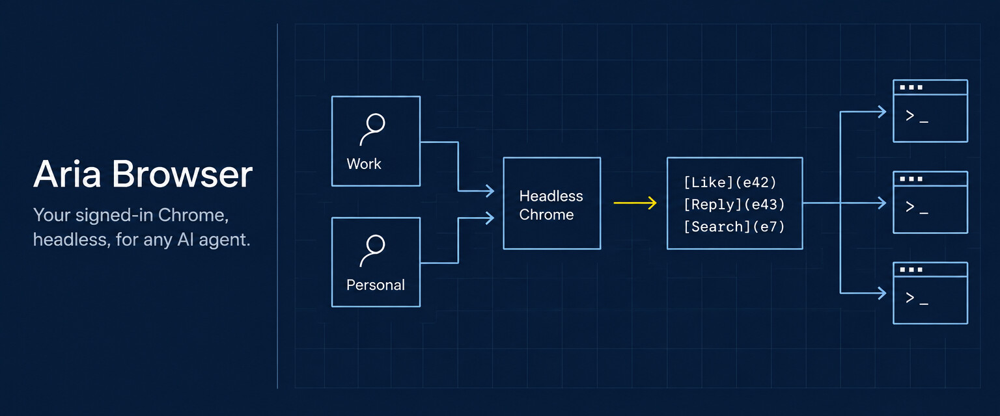
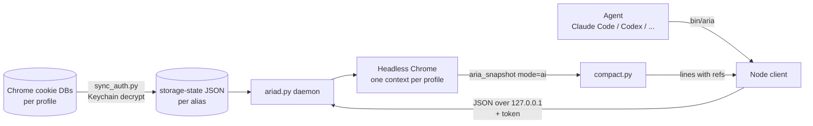

<p align="center">
  
</p>

<h1 align="center">Aria Browser</h1>

<p align="center">
  Lets any AI coding agent read and click through websites you're already signed in to, in a headless Chrome that never opens a window.
</p>

<p align="center">
  <a href="#install"><b>Install</b></a> ·
  <a href="#architecture">Architecture</a> ·
  <a href="#benchmarks">Benchmarks</a> ·
  <a href="#commands">Commands</a>
</p>

<p align="center">
  
</p>

## Why

I wanted my agents (Claude Code, Codex, Antigravity) to read my X timeline, my LinkedIn feed and Reddit threads, and to click through internal tools I'm signed in to. The browser extensions that do this belong to one vendor and drive the one Chrome window I'm using. They also block some sites outright and send back a lot of text for each page.

Aria Browser is an [agent skill](https://github.com/vercel-labs/skills): a small CLI any agent can call. It copies the sign-ins from your own Chrome profiles into a headless Chrome. It keeps that browser running between calls, and returns each page as short lines where every link and button carries a ref the agent can click.

```
1. [upvote](e36) [Voxtral 3](e40) ( [mistral.ai](e42) )
321 points by [ilreb](e47) [3 hours ago](e49) | [hide](e50) | [82 comments](e51)
```

## Features

- **Signed in as you.** Cookies are read from Chrome's own encrypted store (macOS Keychain) for every Chrome profile, so `--profile work` and `--profile personal` run side by side.
- **Never takes focus.** Real Google Chrome runs headless: no window, no Dock icon, and it doesn't touch your open Chrome.
- **Compact snapshots with refs.** Built on Playwright's AI-mode accessibility snapshot, then flattened: wrappers dissolved, inline text joined, URLs dropped unless asked for. Hacker News's front page is about 1.5k tokens with every story's points and ref.
- **Fast after the first call.** A background daemon keeps Chrome, tabs and refs alive. Clicks and finds come back in under a second, and a page open is about as long as the site takes to load.
- **The full action set.** Click, type, press, hover, select, check, upload, scroll, back/forward, wait-for, screenshots, PDF, `eval`, console and network logs, `fetch` as the signed-in user, and tabs. `batch` runs several commands in one call.
- **Cheap follow-ups.** `--diff` returns only the lines that changed since the last snapshot, and `--filter`, `--ref` and `--max` narrow any read.
- **Recovers sign-ins.** If a page shows a login wall, it re-reads cookies from Chrome once and reloads. HTTP 4xx/5xx, including rate limits, appear in the result header.

## Architecture



**A daemon, not a script.** The first version launched Chrome for every call: about 4 to 5 seconds before anything happened, and no way to click something you'd just read. The daemon starts on the first call, warms Chrome, and listens on a random localhost port. The port and a random token sit in `~/.cache/aria-browser/ariad.json` (mode 600). It exits after 30 minutes idle.

**Refs from Playwright's AI snapshot.** `page.aria_snapshot(mode="ai")` tags every node with a ref that resolves through the `aria-ref=` selector, including nodes inside iframes. `compact.py` keeps those refs and throws away the rest of the YAML. Refs from the page's main frame are shown without their frame prefix and resolved back to the full ref.

**Recently used cookies first.** Chrome keeps about 3,300 cookies per profile (180 per site) and drops extras without an error. A real profile has 7,000 or more. Loaded naively, the eviction took X's login cookie with it. The sync writes cookies oldest-first by last access, and the daemon loads the newest within the caps, so the sites you use stay signed in.

**Wait for the page to settle, not a fixed number of seconds.** After `domcontentloaded`, the daemon polls the page's text length. It returns once the length has held steady for 350 ms, ignoring changes under 2% (live counters) and staying put while a visible spinner is on screen. The ceiling is 3.5 s, so fast pages return fast and feeds wait for their posts.

**Text that sees shadow DOM.** `--text` reads `innerText` from `<main>`, falling back to `<body>` when `<main>` holds only part of the page. If that still misses content, as with Reddit's web components, it uses the accessibility tree's text instead, since that one sees inside shadow roots.

## Install

Needs macOS (for the Keychain cookie sync), Google Chrome, Node 18+ and Python 3.10+.

```sh
npx skills add albertyu647/aria-browser -g          # installs to ~/.agents/skills for your agents
pip install -r ~/.agents/skills/authed-silent-chrome-browser-aria/requirements.txt

A=~/.agents/skills/authed-silent-chrome-browser-aria/bin
node $A/cli.js --list                                  # your Chrome profiles
node $A/cli.js --alias work=Default --alias personal="Profile 2" --default personal
node $A/cli.js                                         # sync cookies (macOS asks for Keychain access)
$A/aria open news.ycombinator.com
```

Running `node bin/cli.js` again re-syncs after you sign in to something new in Chrome. You can also run `aria resync` while the daemon is up.

## Commands

| Need | Command |
|---|---|
| Navigate | `open <url> [--new] [--text] [-i] [--no-snap] [--filter a\|b] [--max N]` |
| Read | `snap [-i] [--ref eN] [--diff] [--urls]`, `text [--selector css]`, `find <words>` |
| Act | `click`, `type [--submit]`, `press <Key>`, `hover`, `select`, `check [--off]`, `upload` |
| Move | `scroll down\|up\|top\|bottom\|<ref>`, `back`, `forward`, `reload`, `wait [--for text] [--url part]` |
| Capture | `shot [path] [--full] [--ref eN]`, `pdf <path>` |
| Debug | `eval "<js>"`, `console [--errors]`, `network [--failed]`, `fetch <url>` |
| Tabs | `tabs`, `tab new [url]`, `tab use t2`, `tab close` |
| Several at once | `batch 'open x.com/home --no-snap' 'find search' 'type e12 "hello"'` |
| Sign-ins | `resync`, `cookies-check` (which sites have a session cookie, names only) |

Any action takes `--snap`, `--text` or `--diff` to read the page in the same call. [SKILL.md](SKILL.md) is the version agents read.

## Benchmarks

Same tasks, same Mac, against Claude in Chrome driving the real browser (October 2026). Tokens are output characters ÷ 4, which is what the agent reads. Aria times are wall clock, including the CLI. Chrome times were measured inside its batch with `Date.now()`, which leaves out its own call overhead and favors it.

| Task | Aria | Claude in Chrome |
|---|---|---|
| Hacker News, read 30 stories | 0.71 s · 1,016 tok · 29 stories | 0.96 s · 1,100 tok · 29 stories |
| Hacker News, read with clickable refs | 0.71 s · 1,519 tok · 29 stories with points | 1.03 s · 3,300 tok · ~24 stories, links only |
| LinkedIn feed | 2.95 s · 629 tok · 2 posts | 2.86 s · 1,100 tok · 3 posts |
| Reddit home feed | 1.4 s · 5 posts | blocked by the extension |
| X home timeline | 3.1 s · 8 posts | 4.7 s · 0 to 1 posts |
| X, scroll for more | 9 posts · 1,528 tok | 1 post + a screenshot |
| Click "new" on HN | 1.57 s · 39 tok | 2.3 s (its `find` alone is 1.2 s) |
| Wikipedia search | 1.71 s · works | page never navigated |
| Tasks passing | 12 / 12 | 3 / 10 |

First call of a session: about 2.4 s while Chrome starts. LinkedIn is a tie, mostly server time.

```sh
python3 bench/evals.py     # 20 feature checks: forms, iframes, tabs, console, two profiles, signed-in X
python3 bench/bench.py     # timings and tokens vs bench/chrome_baseline.json
```

The benchmark loads real sites. Reddit returned HTTP 429 after about 40 loads in a few minutes, so it now runs Reddit tasks once per pass.

## Project structure

```
SKILL.md              what agents read: commands, token tips, sign-in notes
bin/cli.js            Node client; starts the daemon on demand (bin/aria is a shell shim)
scripts/ariad.py      the daemon: Chrome, contexts, tabs, commands
scripts/compact.py    AI snapshot YAML -> compact lines with refs
scripts/sync_auth.py  Chrome cookie DB -> Playwright storage state, per profile
scripts/profiles.py   profile aliases in ~/.config/chrome-storage-states/profiles.json
scripts/browse.py     the original one-shot browser (kept for reference)
bench/                evals.py, bench.py, chrome_baseline.json
```

## Tech stack

Python (Playwright, cryptography), Node (client), Google Chrome via Playwright's `channel="chrome"`.

## Notes

- Use it with your own accounts, and stay within each site's terms and rate limits. It sends real requests as you.
- The cookie copies in `~/.config/chrome-storage-states/` are as sensitive as your passwords. They stay on your machine; keep them out of repos and backups you share.
- The cookie sync is macOS-only for now. The daemon and client are plain Playwright and Node, but untested on Windows and Linux.
- Not affiliated with Google, Anthropic, OpenAI, Microsoft (Playwright), X, Reddit or LinkedIn.
- MIT license.
